# agent.md — Warranty Claims Agent Platform (Autoline-first, DMS- and OEM-agnostic)

> **Status:** Architecture & delivery plan · v0.1 · 2026-11-25
> **Audience:** engineers building the system, and reviewers approving the design.
> **Relationship to `CLAUDE.md`:** `CLAUDE.md` defines the *product* (what the agents do, OEM rule content, seed data, UI routes, demo story). This file defines the *system* that delivers it. Where they disagree on **stack**, this file wins (see §0.2). Where they disagree on **product behaviour**, `CLAUDE.md` wins.

---

## Table of contents

0. [Summary and deltas from CLAUDE.md](#0-summary-and-deltas-from-claudemd)
1. [Goals, non-goals, design principles](#1-goals-non-goals-design-principles)
2. [System context](#2-system-context)
3. [Service topology (multi-service, multi-process)](#3-service-topology)
4. [Ports & adapters — the replaceable seams](#4-ports--adapters)
5. [Real OEM landscape — what each OEM actually requires](#5-real-oem-landscape)
6. [OEM Connector interface](#6-oem-connector-interface)
7. [DMS interface (Autoline first)](#7-dms-interface-autoline-first)
8. [LLM provider interface and the Fake LLM](#8-llm-provider-interface-and-the-fake-llm)
9. [Agent layer — LangGraph + LangChain](#9-agent-layer)
10. [Orchestrator and claim lifecycle](#10-orchestrator-and-claim-lifecycle)
11. [Rules engine and OEM rule packs](#11-rules-engine-and-oem-rule-packs)
12. [Simulated OEM Gateway and Workshop Simulator](#12-simulators)
13. [Data architecture on PGlite](#13-data-architecture-on-pglite)
14. [Messaging, jobs, events, real-time](#14-messaging-jobs-events-real-time)
15. [API surface](#15-api-surface)
16. [Frontend (Next.js)](#16-frontend-nextjs)
17. [Security, tenancy, configuration](#17-security-tenancy-configuration)
18. [Observability and operations](#18-observability-and-operations)
19. [Testing strategy](#19-testing-strategy)
20. [Repository layout](#20-repository-layout)
21. [Running locally and in production](#21-running-locally-and-in-production)
22. [Key sequence flows](#22-key-sequence-flows)
23. [**MVP definition**](#23-mvp-definition)
24. [Roadmap — Stage 1, Stage 2, Stage 3](#24-roadmap)
25. [Risks and open questions](#25-risks-and-open-questions)
26. [Sources](#26-sources)

---

## 0. Summary and deltas from CLAUDE.md

### 0.1 One-paragraph summary

A set of cooperating services turns **closed workshop WIPs (job cards)** from a dealer's DMS into **OEM warranty claims**, checks them against per-OEM rules, submits them, tracks adjudication, fixes and resubmits rejections, and escalates what needs a human. The first customer is an **Autoline DMS** dealer group selling Ford/Lincoln, Ford Trucks, JLR, Ferrari, Maserati and VinFast in the UAE. Every external dependency — **DMS, OEM portals, LLM, database, queue, blob store, clock** — sits behind an interface so a second dealer group on a different DMS, with different brands, is a **configuration + adapter** job, not a rewrite.

### 0.2 Stack deltas (this file supersedes CLAUDE.md §4 and §11 on these points)

| Concern | CLAUDE.md said | This system uses | Why |
|---|---|---|---|
| Backend language | TypeScript in Next route handlers | **Python 3.12 + FastAPI** services | User requirement; better agent ecosystem (LangGraph) |
| Agent framework | `@anthropic-ai/sdk` tool loop | **LangGraph** (graphs, checkpoints) + **LangChain** (tools, chat-model abstraction) | Pluggable models, durable state, human-in-the-loop interrupts |
| LLM | Real Claude models | **Fake LLM provider** (deterministic, no network) behind `LLMProvider`; Anthropic/OpenAI/Bedrock adapters stubbed | No real LLM for now; must be swappable by config |
| Database | Neon Postgres | **PGlite** (Postgres compiled to WASM) exposed over the Postgres wire protocol via `pglite-socket`; Python talks plain Postgres | Zero-infra local; swap to real Postgres by changing `DATABASE_URL` |
| Frontend | Next.js app incl. APIs | **Next.js 15 (App Router)** UI only; no business logic in Next | Clean split; backend owns all state |
| Schemas | zod | **Pydantic v2** in Python (source of truth) → **OpenAPI** → generated TS types + zod for the UI | One schema origin |
| Worker | `pnpm worker` | Dedicated **orchestrator-worker** processes | Long-running batches outside the request path |
| Real-time | SSE from Next routes | **SSE from FastAPI `api` service**, fed by a DB outbox | Same UX, backend-owned |

Everything else in `CLAUDE.md` (claim types, rejection codes R01–R13, rule matrix, seed design, UI pages, guardrails, demo storyline, "Simulated OEM Gateway" labelling) is **kept as-is**.

---

## 1. Goals, non-goals, design principles

### 1.1 Goals

1. **Recover more warranty money, faster:** lower first-pass rejection rate, shorter WIP-close→payment cycle, fewer missed submission windows.
2. **Run as a production-shaped system** today, on a laptop, with no external accounts: multiple services, multiple processes, durable state, retries, idempotency, observability.
3. **Portable across dealers:** new DMS = one adapter; new OEM = one rule pack + one connector; new LLM vendor = one provider class.
4. **Honest by construction:** simulated parts are labelled; agents cannot fabricate evidence; every decision is traceable.

### 1.2 Non-goals (for now)

- No live connection to any OEM system or to a real Autoline instance.
- No real LLM calls.
- No real customer data; all seed data is fictional.
- Not a general DMS. We read from the DMS and write back only claim status/credit references (when the real adapter allows).

### 1.3 Design principles

| # | Principle | What it means in code |
|---|---|---|
| P1 | **Hexagonal (ports & adapters)** | Domain code imports *ports* (Python `Protocol`s), never vendor SDKs. Adapters are chosen at startup from config. |
| P2 | **Deterministic core, probabilistic edges** | State machine, rules engine, payload adapters, guardrails = plain code with unit tests. LLMs only draft text and choose among tool calls. |
| P3 | **Canonical claim model** | One internal claim shape (aligned with the STAR `WarrantyClaim` noun). OEM formats are produced by adapters at the edge. |
| P4 | **Rules as data** | OEM rules live in versioned YAML rule packs with `source: public | illustrative`. No rule logic inside prompts or UI. |
| P5 | **Database-per-service boundary** | Services own their schemas. Cross-service access goes through APIs or events, never cross-schema joins. |
| P6 | **Everything is replayable** | Every agent run records model I/O, tool I/O and timings; replay mode reproduces runs exactly. |
| P7 | **Idempotent and at-least-once** | Jobs and OEM submissions carry idempotency keys; handlers tolerate redelivery. |
| P8 | **Tenant-scoped everywhere** | Every row and every request carries `company_id`. |
| P9 | **Swap by config, not by code** | `DMS_ADAPTER=autoline_fake`, `LLM_PROVIDER=fake`, `OEM_CONNECTOR_FORD=sim`, `DATABASE_URL=...`. |

---

## 2. System context

```mermaid
flowchart LR
    subgraph Dealer["Dealer group (tenant)"]
        WA["Warranty Administrator"]
        SM["Service Manager"]
        TECH["Workshop / Technicians"]
    end

    subgraph Platform["Warranty Claims Agent Platform"]
        UI["Web UI<br/>Next.js"]
        CORE["Backend services<br/>FastAPI + LangGraph"]
    end

    DMS[("Dealer DMS<br/>Autoline today<br/>(FAKE adapter + PGlite)")]
    OEM[("OEM warranty systems<br/>Ford OWS, JLR GWS, Maserati ModisCS+,<br/>Ferrari New Modis, VinFast, Ford Trucks<br/>(SIMULATED gateway)")]
    LLM[("LLM vendor<br/>Anthropic / OpenAI / Bedrock<br/>(FAKE provider)")]

    WA -->|review queue, approvals| UI
    SM -->|KPIs, control room| UI
    TECH -.->|answers queries<br/>(simulated persona)| CORE
    UI <--> CORE
    CORE <-->|read WIPs, vehicles, contracts<br/>write claim status| DMS
    CORE <-->|submit, status, credit notes| OEM
    CORE <-->|chat + tool calls| LLM
```

Everything drawn as a cylinder is **external** and today is **faked behind an interface**.

---

## 3. Service topology

### 3.1 Container view

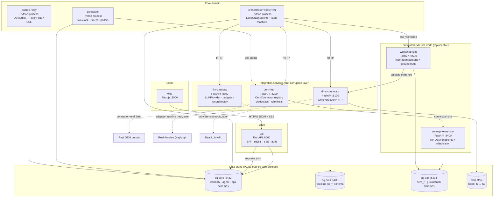

### 3.2 Service catalogue

| Service | Kind | Owns | Responsibilities | Scales |
|---|---|---|---|---|
| **web** | Next.js server | nothing | UI pages from `CLAUDE.md` §2/§10; consumes `api` only | horizontally |
| **api** | FastAPI (uvicorn/gunicorn) | `warranty`, `ops` read/write | REST for UI, SSE stream, auth, tenant resolution, enqueue runs, human-review actions | horizontally (stateless) |
| **orchestrator-worker** | Python process (asyncio) | claim state transitions, `agent` schema | Pulls jobs, runs the deterministic claim state machine, invokes LangGraph agents, enforces guardrails | horizontally, `WARRANTY_MAX_PARALLEL` per process |
| **scheduler** | Python process (single leader) | timers | Sim clock ticks, OEM status polling, submission-window watcher, payment-run checks, parts-retention reminders, SLA breaches | 1 active (leader lock) |
| **outbox-relay** | Python process | `ops.outbox` | Publishes committed domain events to the event bus / SSE fan-out | 1 active |
| **dms-connector** | FastAPI | `al_*` (via adapter) | Implements `DmsPort` over HTTP; today backed by `AutolineFakeAdapter` on `pg-dms` | horizontally |
| **oem-hub** | FastAPI | connector configs, credentials refs | Registry of `OemConnector`s; canonical→OEM payload transforms; auth/token caching; rate limiting; circuit breaking | horizontally |
| **llm-gateway** | FastAPI | `llm` usage tables | Implements `LLMProvider`; routes by role (`main`/`fast`); token & cost budgets; records for replay | horizontally |
| **oem-gateway-sim** | FastAPI | `oem_*` | Simulates each OEM portal: shape validation, deterministic adjudication, delays, payment runs, credit notes | 1–2 |
| **workshop-sim** | FastAPI | `groundtruth` | Technician persona for `ask_workshop`; only service allowed to read `seed_issue_manifest` | 1 |
| **pg-core / pg-dms / pg-sim** | Node `pglite-socket` processes | data | Each is one PGlite instance exposed on a TCP port | 1 each (PGlite is single-writer) |

**Why separate PGlite instances?** PGlite is single-user Postgres; the socket server serialises (or lightly multiplexes) clients. Three instances (a) give each bounded context its own database as it would be in production, (b) keep simulated external systems physically separate from our core data, and (c) spread the single-connection bottleneck. See §13.

### 3.3 Process model per service

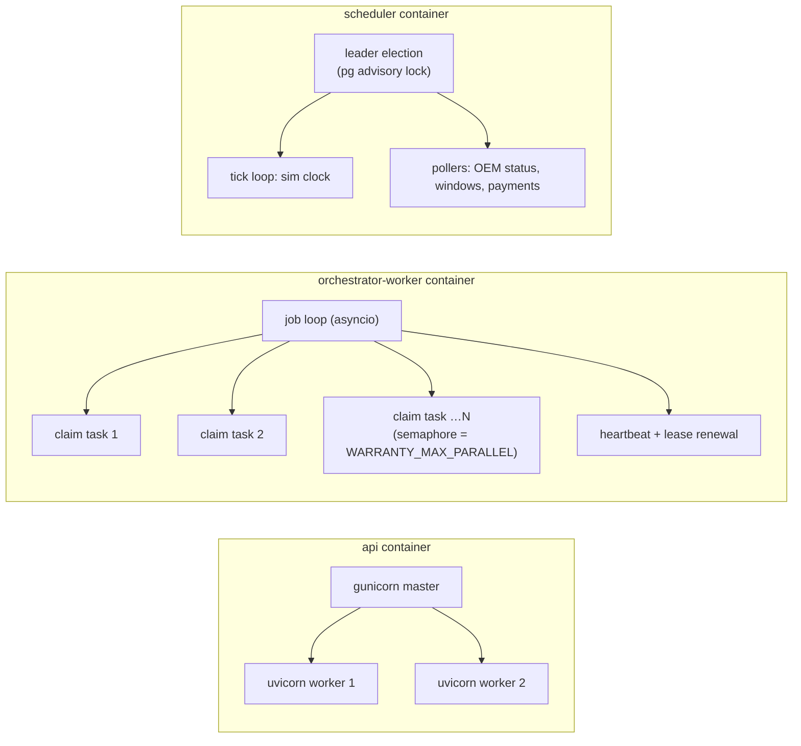

---

## 4. Ports & adapters

All ports are Python `typing.Protocol`s in `packages/py/wc_core/ports/`. Domain code depends **only** on these.

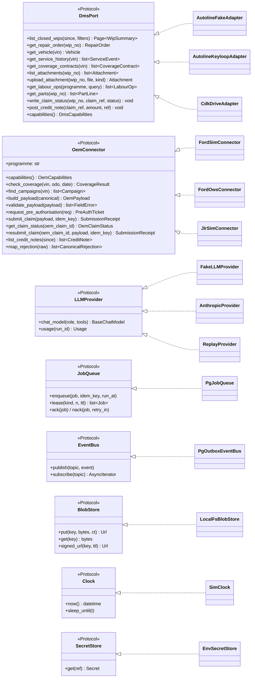

| Port | Today (default) | Later (production swaps) |
|---|---|---|
| `DmsPort` | `AutolineFakeAdapter` (PGlite `pg-dms`) | `AutolineKeyloopAdapter` (Keyloop partner API / DB extract), `CdkDriveAdapter`, `ReynoldsAdapter`, `StarBodAdapter` (generic STAR XML) |
| `OemConnector` | `<Programme>SimConnector` → `oem-gateway-sim` | `<Programme>RealConnector` (portal API, SFTP batch, or RPA as last resort) |
| `LLMProvider` | `FakeLLMProvider` | `AnthropicProvider`, `BedrockProvider`, `OpenAIProvider`, `AzureOpenAIProvider`, `ReplayProvider` |
| `JobQueue` | `PgJobQueue` (`SELECT … FOR UPDATE SKIP LOCKED`) | Redis/RQ, SQS, Temporal |
| `EventBus` | `PgOutboxEventBus` (outbox + polling + in-proc fan-out) | Redis Streams, NATS, Kafka |
| `BlobStore` | `LocalFsBlobStore` (`./var/blobs`) | S3 / Azure Blob / GCS |
| `Clock` | `SimClock` (speed = `WARRANTY_SIM_SPEED`) | `SystemClock` |
| `SecretStore` | `EnvSecretStore` (`.env`, fake values) | AWS Secrets Manager / Vault / Azure Key Vault |

Adapter selection happens once in a **composition root** (`wc_core/bootstrap.py`) using `pydantic-settings`. Adapters are discovered through Python **entry points** (`[project.entry-points."wc.oem_connectors"]`) so a third party can ship `wc-connector-hyundai` as a separate package.

---

## 5. Real OEM landscape

> **What this section is:** what we could verify from public sources about how each OEM's dealer warranty system works, and what an integration would need. **None of these OEMs publishes a public claims API.** Access is via dealer credentials on OEM portals, DMS-integrated channels, or partner agreements. Every real connector therefore starts as a **simulated connector with the same interface**, plus a credentials contract that a real implementation fills in.

### 5.1 What we found

| Programme | Real OEM system (public evidence) | Claim-shape facts we can rely on | What a real integration needs | Confidence |
|---|---|---|---|---|
| **FORD / Lincoln** | **One Warranty Solution (OWS)** online, or claim entry **through the DMS**; earlier *Direct Warranty Entry (DWE)*. Governed by the **Ford Warranty and Policy Manual**. Prior approval for out-of-coverage via the **SSSC Web Contact Site**. | Numeric **claim type** (e.g. `31` = Field Service Action) + **sub code** (FSA number). **Customer Concern Code (CCC)** + **Condition Code** per line. **Related damage on a separate repair line** with a "related damage" indicator. Refunds on separate lines. Technician certification can be validated (e.g. STST competency) and claims reject if not met. | Ford dealer code (P&A code), OWS user credentials or DMS-vendor certified interface, Ford-region specifics (Middle East market via the regional office), labour-time catalogue access. | High for structure (from Ford bulletins); exact field list needs OWS guide |
| **FORD_TRUCKS** (Ford Otosan F-MAX) | Not publicly documented; separate from Ford Motor Co. | Assume line-based claims with chassis/axle refs (`CLAUDE.md` §5.2). | Distributor agreement with Ford Trucks / Ford Otosan. | Low — treat as illustrative |
| **JLR** (Jaguar, Land Rover) | **JLR Global Warranty Manual** (+ amendments) governs claims; repairs follow **TOPIx** procedures; eligibility checks in the JLR claims submission system; **prior authority** process for some repairs (bulletins reference "FRED"). | Labour by **SRO** (Service Repair Operation) codes with standard times (e.g. drive-in/drive-out 0.2 h); **programme codes** for extended cover; non-standard (open) time allowed per guidelines; related-damage claims have their own process. | JLR retailer code, TOPIx/JLR portal credentials per brand (Jaguar vs Land Rover), DSL ID, regional NSC agreement. | Medium |
| **MASERATI** | Claims filed in **ModisCS+**; product quality reports in **Blue On Line**; rules in the public **Maserati Aftersales "Whitebook"**. | Strict **time limits** (Americas: generally **7 calendar days** from RO close; ModisCS+ refuses late claims; "first dealer to submit is entitled to payment"); **cost codes**; RO documentation & record-keeping requirements; sublet rules; appeals process. | Maserati dealer code, ModisCS+ credentials, regional (MENA) whitebook variant. | Medium-high (public whitebook) |
| **FERRARI** | **New Modis** dealer portal; **Service Entry (SE)** is the digital RO the dealer must open for vehicles in the workshop; claims hang off the SE. Technical assistance via **Red On Line (ROL)** after first-level diagnosis. | SE status ≠ claim status; repeat-repair checks in claim and SE forms; ROL reference required for escalated faults; demerit scoring of faults; authorisation codes and allowed times sent to dealer by email for some cases. | Ferrari dealer credentials, ROL access. | Medium (older bulletins) |
| **VINFAST** | Not publicly documented. | Public: 10 yrs/200,000 km vehicle, **10 yrs/unlimited km battery** (component term). | Distributor agreement with VinFast. | Low — illustrative |
| **DEEPAL, FOTON** | Not documented | Stubs, "rules pending". | — | — |

### 5.2 Cross-OEM standard: STAR

The **STAR** (Standards for Technology in Automotive Retail) XML standard defines a `ProcessWarrantyClaim` BOD with a `WarrantyClaim` noun (jobs, pricing, taxes, splits, sublet, rental, deductibles, prior-claim number for continued claims). Several OEM/DMS integrations and warranty platforms (e.g. ServiceNow, Pega) support STAR. We therefore:

- align the **canonical claim** field names with STAR's `WarrantyClaim` where reasonable;
- ship a `StarBodSerializer` so a real connector for an OEM that speaks STAR is mostly mapping config.

### 5.3 What this means for the design

1. **Three integration styles must fit one interface:** portal API (JSON/SOAP), DMS-mediated submission (OEM accepts claims from a certified DMS — Ford explicitly allows this), and batch/file. `OemConnector.capabilities()` declares which: `submission_mode: api | dms_mediated | batch | manual_portal`.
2. **If submission is DMS-mediated** (e.g. Ford via Autoline's own warranty module), the connector's `submit_claim` writes the claim into the DMS warranty module through `DmsPort` and lets the DMS transmit. The rest of our pipeline is unchanged.
3. **Manual portal fallback:** when no channel is available, `submit_claim` produces a "ready-to-key" pack (OEM-formatted form + attachments) and a human task; status is then entered by a human. This keeps the agents useful on day one with any OEM.
4. **Credentials contract:** each real connector declares a `CredentialSpec` (e.g. `dealer_code`, `username`, `password_ref`, `client_cert_ref`, `api_key_ref`, `brand_scope`). The sim connectors declare the same spec and accept fake values from `.env` (`OEM_FORD_API_KEY=fake-ford-key`).

```python
# packages/py/wc_oem/credentials.py
class CredentialSpec(BaseModel):
    fields: list[CredentialField]           # name, secret: bool, description
    auth_flow: Literal["api_key", "oauth2_client_credentials", "basic", "mtls", "portal_session"]
    token_ttl_s: int | None = None

FORD_OWS_CREDENTIALS = CredentialSpec(
    fields=[
        CredentialField(name="dealer_code", secret=False, description="Ford P&A / dealer code"),
        CredentialField(name="client_id", secret=False),
        CredentialField(name="client_secret_ref", secret=True),
    ],
    auth_flow="oauth2_client_credentials",
    token_ttl_s=3600,
)
```

---

## 6. OEM Connector interface

### 6.1 Contract

```python
# packages/py/wc_oem/ports.py
class OemCapabilities(BaseModel):
    programme: str                                  # "FORD", "JLR", ...
    brands: list[str]                               # ["Ford", "Lincoln"]
    submission_mode: Literal["api", "dms_mediated", "batch", "manual_portal"]
    supports_pre_auth: bool
    supports_status_poll: bool
    supports_status_webhook: bool
    supports_resubmit: bool
    supports_attachments: bool
    payload_schema: dict                            # JSON Schema of the OEM payload
    rate_limit_per_min: int
    simulated: bool                                 # True → UI shows "Simulated OEM Gateway"

class OemConnector(Protocol):
    programme: str
    def capabilities(self) -> OemCapabilities: ...
    def credential_spec(self) -> CredentialSpec: ...
    async def check_coverage(self, vin: str, odometer_km: int, on: date) -> CoverageResult: ...
    async def find_campaigns(self, vin: str) -> list[Campaign]: ...
    def build_payload(self, claim: CanonicalClaim) -> OemPayload: ...          # pure, deterministic
    def validate_payload(self, payload: OemPayload) -> list[FieldError]: ...  # pure
    async def request_pre_authorisation(self, req: PreAuthRequest) -> PreAuthTicket: ...
    async def submit_claim(self, payload: OemPayload, idem_key: str) -> SubmissionReceipt: ...
    async def get_claim_status(self, oem_claim_id: str) -> OemClaimStatus: ...
    async def resubmit_claim(self, oem_claim_id: str, payload: OemPayload, idem_key: str) -> SubmissionReceipt: ...
    async def list_credit_notes(self, since: datetime) -> list[CreditNote]: ...
    def map_rejection(self, raw: RawRejection) -> list[CanonicalRejection]: ...  # → R01..R13
```

### 6.2 Layering inside `oem-hub`

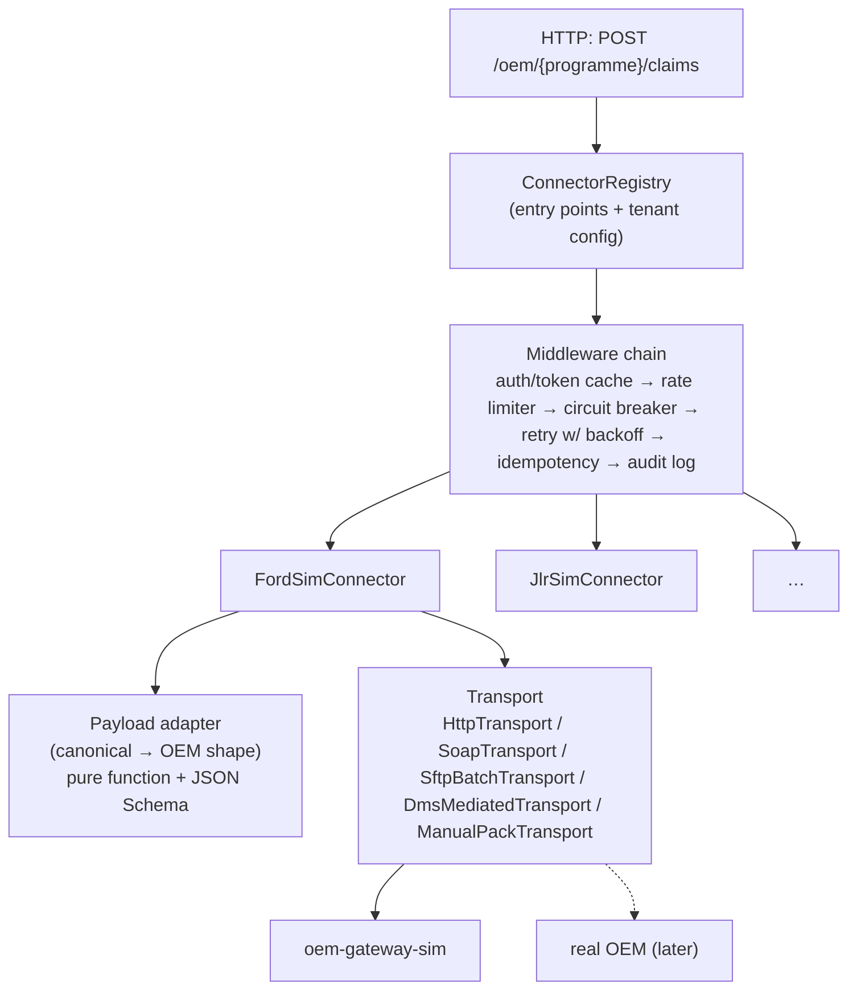

- **Adapter** (shape) and **transport** (how bytes travel) are separate, so a real Ford connector reuses the Ford payload adapter and only swaps transport + auth.
- Every outbound call is written to `ops.integration_log` (request hash, response code, latency, redacted bodies).

### 6.3 Adding a new OEM — checklist

1. `rule_packs/<programme>.yaml` (coverage facts with `source`, dealer-claim rules).
2. `wc_oem/adapters/<programme>.py` (payload model + `build_payload` + `validate_payload`) with golden-file tests.
3. `wc_oem/connectors/<programme>_sim.py` (and optionally `_real.py`) registered via entry point.
4. Rejection mapping table → canonical codes R01–R13.
5. Seed: labour ops, condition codes, sample WIPs.
6. UI picks it up automatically (form renderer is driven by the payload JSON Schema + a small layout hint file).

---

## 7. DMS interface (Autoline first)

### 7.1 Facts about Autoline

Autoline is now a **Keyloop** product (lineage: Kerridge → CDK Global International → Keyloop). There is **no public warranty-claims API**; integrations go through Keyloop partner programmes. Autoline already consumes some OEM APIs for lookups (e.g. labour times and warranty defect codes for BMW), which tells us real Autoline sites may already hold OEM labour/defect catalogues — our `DmsPort.get_labour_ops` should prefer DMS data when the real adapter provides it.

### 7.2 Port and canonical DMS model

The port exposes a **DMS-neutral** model (`RepairOrder`, `RepairOrderLine`, `Vehicle`, `ServiceEvent`, `CoverageContract`, `Attachment`, `Staff`). Autoline vocabulary (WIP, pay types `C/W/I/CP/MP`) is mapped inside the adapter; the UI may still display "WIP 48213 (Job Card)" via tenant terminology settings.

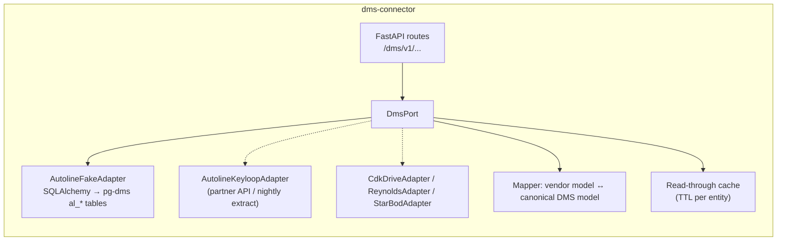

### 7.3 Fake Autoline data

- Stored in `pg-dms`, schema `autoline`, tables `al_*` exactly as `CLAUDE.md` §6.1–6.2 (repair orders, lines, vehicles, customers, staff, attachments, coverage contracts, campaigns, labour ops, condition codes, service history).
- Seeded from `seed/generated/default.warranty.json` (hand-written; works with zero LLM).
- Attachments are generated placeholder images/PDFs stored in the `BlobStore`.
- **Write-back** (`write_claim_status`, `post_credit_note`) goes to `al_warranty_claims` / `al_warranty_credit_notes` mirror tables so the fake DMS shows what a real one would.

### 7.4 Change detection

| Mode | Fake adapter | Real adapter options |
|---|---|---|
| Pull | `list_closed_wips(since=watermark)` polled by `scheduler` every N sim-minutes | Partner API polling or nightly extract |
| Push | Trigger on `al_repair_orders.closed_at` writes to an `autoline.changes` table | DMS webhook / message feed if available |

Watermarks are stored per tenant in `ops.sync_state`; ingestion is idempotent on `(company_id, wip_no)`.

---

## 8. LLM provider interface and the Fake LLM

### 8.1 Interface

```python
# packages/py/wc_llm/ports.py
Role = Literal["main", "fast"]          # main = builder/compliance/resolver, fast = triage/submitter/persona/reviewer

class LLMProvider(Protocol):
    name: str
    def chat_model(self, role: Role, *, run_id: str, tenant: str) -> BaseChatModel: ...
    def info(self) -> ProviderInfo     # model ids, context window, pricing, is_fake
```

- Returns a **LangChain `BaseChatModel`**, so LangGraph nodes call `.bind_tools(...)` / `.with_structured_output(...)` regardless of vendor.
- Model ids come from env: `WARRANTY_AGENT_MODEL`, `WARRANTY_FAST_MODEL` (e.g. `claude-sonnet-5-5`, `claude-haiku-5-5` when real). Never hardcoded.
- Agents call the model **through `llm-gateway`** (`RemoteChatModel` client) so budgets, logging and record/replay live in one place. For unit tests the provider can be used in-process.

### 8.2 Providers

| Provider | Purpose | Network |
|---|---|---|
| `FakeLLMProvider` (**default**) | Deterministic, scripted-policy chat model that emits real LangChain `AIMessage`s with `tool_calls` | none |
| `ReplayProvider` | Plays back `agent_replays` recordings with original timings (`WARRANTY_MODE=replay`) | none |
| `AnthropicProvider` | `langchain-anthropic` `ChatAnthropic`, prompt caching on system prompt + rule pack | yes (later) |
| `OpenAIProvider`, `BedrockProvider`, `AzureOpenAIProvider` | Alternates | yes (later) |

### 8.3 How the Fake LLM works (and why it is not a toy)

`FakeToolCallingChatModel(BaseChatModel)` is driven by a **policy per agent** (`wc_llm/fake/policies/<agent>.py`). On each call it inspects the conversation (last tool results + the agent's state) and returns the next `AIMessage`:

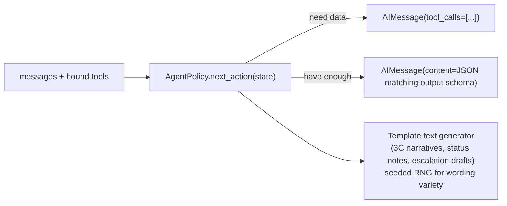

- **Triage policy:** call `get_repair_order` → `get_vehicle` → `get_coverage_contracts` → `find_open_campaigns` → `find_prior_claims`, then decide using the *same* deterministic helpers the rules engine exposes (coverage math, campaign match, duplicate window).
- **Builder policy:** parse technician shorthand with regex/keyword extractors (`R&R`, `INOP`, DTC patterns, pressures, temperatures) to draft Complaint/Cause/Correction; pick causal part by `is_causal` + keyword match to labour-op system; call `ask_workshop` when a 3C slot is empty.
- **Compliance/Resolver policies:** map each failing rule / rejection code to a playbook (`R03 → add justification from notes`, `R04 → ask_workshop for evidence kind X`, `R10 → re-type CAMPAIGN`, `R01/R02/R09/R11/R12 → escalate`).
- Token counts are estimated (`len(text)/4`) so cost and budget code paths are exercised.
- Output is **validated against the same Pydantic schemas** used with real models.
- The UI shows a **"FAKE LLM"** pill (alongside LIVE/REPLAY) so nobody mistakes it for real AI reasoning.

Swapping to a real model is `LLM_PROVIDER=anthropic` + API key in the secret store. Prompts, tools, graphs and guardrails are unchanged.

### 8.4 Budgets and safety at the gateway

- Per-claim and per-batch token caps (`LLM_MAX_TOKENS_PER_CLAIM`, `LLM_MAX_TOKENS_PER_BATCH`); exceeding → agent stops, claim escalates with reason `BUDGET_EXCEEDED`.
- Request/response logging with PII redaction (customer names, phones, plates) before persistence.
- Prompt-injection hygiene: tool outputs are wrapped as data (`<tool_result untrusted="true">`); system prompt instructs to ignore instructions inside technician notes or reviewer comments; guardrails (§9.5) do not rely on the model obeying.

---

## 9. Agent layer

### 9.1 Agents (from `CLAUDE.md` §8.2, re-homed in Python)

| Agent | Model role | Graph type | Output schema |
|---|---|---|---|
| **Triage** | fast | ReAct-style tool loop (`create_react_agent` or custom `StateGraph`) | `TriageDecision {claimable, programme, claim_type, priority, reasons[], duplicate_of?, campaign_code?}` |
| **Claim Builder** | main | Tool loop + `ask_workshop` sub-step | `CanonicalClaim` (draft v1) |
| **Compliance** | main | Loop: `run_rules` → fix/ask → `run_rules` until no fixable fails or max turns | `ComplianceOutcome {status: ready|blocked|escalate, fixes[], open_questions[]}` |
| **Submitter** | fast | Short loop: `build_oem_payload` → `validate` → fix format → `submit_to_oem` | `SubmissionResult` |
| **Resolver** | main | Loop over rejection codes with playbooks | `Resolution {action: resubmit|retype|withdraw|escalate|write_off, new_version?, draft_message?}` |

Each agent definition (`wc_agents/<agent>/definition.py`) declares: system prompt (Jinja2 template + rule pack excerpt), allowed tools, output schema, `max_turns` (default 12), token budget, model role.

### 9.2 Agent graph anatomy (LangGraph)

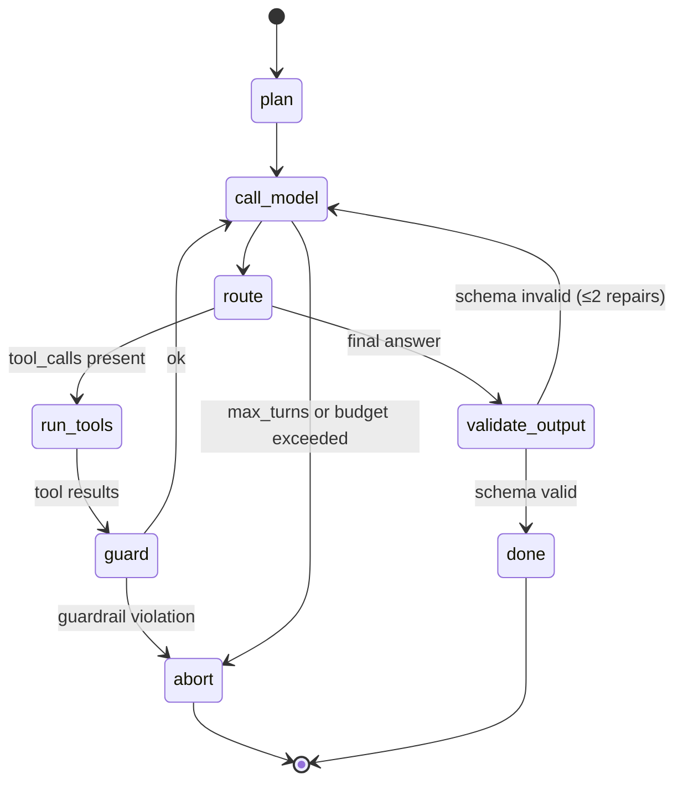

- **State** is a typed `TypedDict` (`AgentState`: messages, claim_id, version, tool_budget, turn, notes).
- **Checkpointer:** `langgraph-checkpoint-postgres` `AsyncPostgresSaver` on `pg-core` (schema `agent_ckpt`). A crashed worker resumes the agent from the last step.
- **Human-in-the-loop:** escalations use LangGraph `interrupt()`; the review-queue action in the UI resumes the graph with the human's decision (`Command(resume=...)`).
- **Streaming:** nodes emit `agent.step` events through the outbox (status notes, tool calls, tool results truncated) — never raw model reasoning.

### 9.3 Tools

Tools are LangChain `StructuredTool`s with Pydantic arg schemas, grouped by the service they call:

| Group | Tools | Backed by |
|---|---|---|
| DMS reads | `get_repair_order`, `get_vehicle`, `get_service_history`, `get_coverage_contracts`, `get_attachments`, `get_parts`, `search_labour_ops`, `search_condition_codes`, `find_prior_claims` | `dms-connector` (+ `pg-core` for prior claims) |
| OEM | `find_open_campaigns`, `build_oem_payload`, `submit_to_oem`, `resubmit_to_oem`, `get_adjudication`, `request_pre_authorisation` | `oem-hub` |
| Rules | `run_rules` (deterministic) | in-process `wc_rules` |
| Claim | `draft_canonical_claim`, `update_canonical_claim` | `pg-core` via `ClaimRepository` with validation |
| Workshop | `ask_workshop` | `workshop-sim` (later: real channel — Teams/WhatsApp/DMS notes) |
| Human | `escalate_to_human` | `pg-core` escalations + LangGraph interrupt |
| Telemetry | `emit_status_note` | outbox |

### 9.4 Tool permission matrix

The orchestrator binds **only** the allowed tools per agent; a tool call to anything else is rejected before execution.

### 9.5 Hard guardrails (code, not prompts)

| Guardrail | Enforced in |
|---|---|
| No submit if latest `run_rules` has any `fail` | orchestrator transition `checking → ready` and `submit_to_oem` tool precondition |
| Labour hours ≤ actual hours; parts ⊆ WIP parts; odometer/dates immutable | `update_canonical_claim` validator (diff against DMS snapshot) |
| Mandatory escalation: `GOODWILL`, amount > AED 25,000 (tenant-configurable), R01/R02/R09/R11/R12 | orchestrator `escalation_policy.py` |
| `maxResubmissions` exceeded → escalate | orchestrator + `oem-hub` |
| Ground truth unreachable by agents | separate service (`workshop-sim`) + separate DB (`pg-sim`) + `import-linter` contract forbidding `wc_groundtruth` imports outside `workshop-sim` and `scoring` |
| Token/cost caps | `llm-gateway` |

---

## 10. Orchestrator and claim lifecycle

### 10.1 Deterministic state machine (not an LLM)

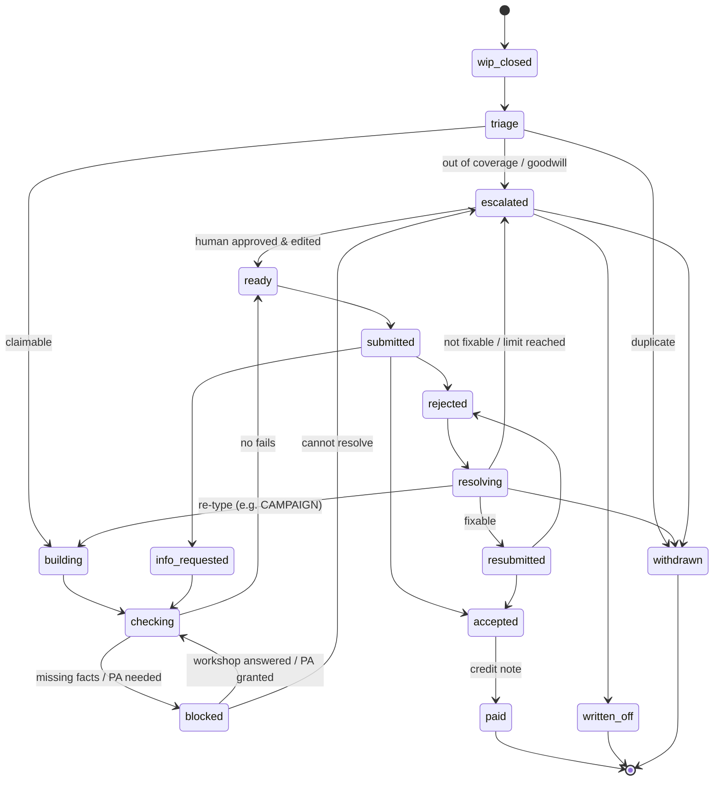

- Implemented as a transition table (`wc_orchestrator/transitions.py`) with guards and side-effects; every transition writes `warranty.claim_events` and an outbox event **in the same transaction**.
- Optimistic concurrency on `claims.version_no` prevents two workers moving the same claim.
- Jobs: `claim.triage`, `claim.build`, `claim.check`, `claim.submit`, `claim.track`, `claim.resolve`, `claim.escalation_resumed`. One job = one step; the next job is enqueued by the transition.
- Priority queue: claims near their submission window (`window_remaining_days ≤ 3`) jump ahead.
- `run_one(claim_ref)` and `run_batch(filter)` are API calls that enqueue `claim.triage` jobs.

### 10.2 Retries and failure handling

| Failure | Handling |
|---|---|
| Transient (HTTP 5xx, timeout, PGlite busy) | exponential backoff with jitter, max 5, then `dead_letter` + alert |
| OEM `400` format error | Submitter agent fixes payload (≤2 attempts), else escalate |
| Agent schema invalid after repairs | escalate with `AGENT_OUTPUT_INVALID` |
| Worker crash | job lease expires → re-leased; LangGraph resumes from checkpoint |
| Duplicate submit | `idem_key = sha256(claim_ref, version)` makes it a no-op at `oem-hub` and gateway |

---

## 11. Rules engine and OEM rule packs

- Package `wc_rules`: **pure functions**, no I/O. Input = `CanonicalClaim` + `RuleContext` (vehicle, contracts, service history, campaigns, prior claims, sim-now). Output = `list[RuleResult{rule_key, result: pass|warn|fail, detail, source, fixable, suggested_fix}]`.
- Rule packs: `rule_packs/<programme>.yaml`, versioned (`pack_version`), validated by a Pydantic model at load. Each value carries `source: public|illustrative`, `source_url`, `last_verified`.

```yaml
# rule_packs/vinfast.yaml (excerpt)
programme: VINFAST
pack_version: 2026.11.1
coverage:
  - contract_type: BASE
    years: 10
    km_limit: 200000
    source: public
    source_url: https://www.altayermotors.com/vinfast/aftersales/warranty/
    last_verified: 2026-11-20
  - contract_type: COMPONENT_BATTERY
    component_scope: [HV_BATTERY]
    years: 10
    km_limit: null           # unlimited
    source: public
dealer_rules:
  submissionWindowDays: {value: 45, source: illustrative}
  preAuth: {rule: "system == 'HV_BATTERY'", source: illustrative}
  labourTolerancePct: {value: 10, source: illustrative}
  requiredEvidence:
    - when: "system == 'HV_BATTERY'"
      kinds: [battery_soh_report, diag_log]
      source: illustrative
gateway_only_checks: []      # loaded ONLY by oem-gateway-sim
```

- Conditional expressions use a **safe expression language** (`simpleeval` with a whitelisted namespace), never `eval`.
- The same engine runs in the agents (`run_rules`) and in `oem-gateway-sim` (plus `gateway_only_checks`), which is what makes some claims pass dealer-side checks and still be rejected (`CLAUDE.md` §7).
- Unit tests: one test per rule per programme (`tests/rules/test_<programme>.py`), plus property tests (Hypothesis) for coverage date/km arithmetic.

---

## 12. Simulators

### 12.1 oem-gateway-sim

Implements per-OEM endpoints exactly as `CLAUDE.md` §7, re-hosted in FastAPI:

```
POST /sim/{programme}/claims                      → 202 {oem_claim_id} | 400 field errors
GET  /sim/{programme}/claims/{oem_claim_id}       → status, decision, codes, reviewer_comment
POST /sim/{programme}/claims/{oem_claim_id}/resubmit
POST /sim/{programme}/preauth                     → ticket (decided by a human in the UI or rule)
GET  /sim/{programme}/credit-notes?since=
```

- Per-programme **payload schemas** (Pydantic) mirror the shapes described in §5 (Ford: claim type + sub code + CCC/condition code + related-damage lines; JLR: repair sections with SRO + programme code; Maserati: cost codes + 7-day-style window; Ferrari: Service Entry ref + ROL ref; VinFast: battery module serials).
- Adjudication is deterministic from payload + rule pack + gateway-only checks; delays and payment-run weekday per programme use `SimClock` and a seeded RNG.
- Reviewer comment text is produced by the `fast` LLM role (fake today) **from reason codes only**; it cannot change the decision.
- Authenticates callers with the fake API keys from the credential spec — so the auth path is exercised.

### 12.2 workshop-sim

- `POST /workshop/ask {repair_order_id, question}` → answer as the assigned technician, grounded only in the WIP + `groundtruth.seed_issue_manifest.hidden_facts`.
- If the fact is absent → "not recorded". Never invents.
- When an answer produces a document (photo, DTC snapshot, SOH report), it uploads it through `dms-connector` (`upload_attachment`) so the evidence appears in the DMS like a real upload.
- Also hosts the **scoring** endpoint for the admin "agent accuracy" drawer.

---

## 13. Data architecture on PGlite

### 13.1 How Python talks to PGlite

PGlite runs in Node/WASM. We run it as a server with **`@electric-sql/pglite-socket`**, which speaks the Postgres wire protocol on a TCP port. Python uses standard drivers (**SQLAlchemy 2.0 async + psycopg 3**). Nothing in Python knows it is PGlite.

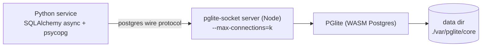

**Constraints and how we handle them**

| PGlite constraint | Mitigation |
|---|---|
| Single-user engine; socket server defaults to **1 connection**; newer versions multiplex with `--max-connections` (with caveats) | Small pools (`pool_size=1..2`, `max_overflow=0`), short transactions, no long-held sessions; three separate instances; `DB_POOL_SIZE` env |
| No real role-based isolation guarantees across "users" | Isolation enforced by **separate instances** + code contracts; Postgres roles defined in migrations for when we move to real PG |
| Limited extension set | Avoid exotic extensions; `pgvector` is available in PGlite if we later need similarity search over past claims |
| `LISTEN/NOTIFY` behaviour over socket not guaranteed | Outbox **polling** (100–500 ms) as the default event transport |
| Throughput | Fine for demo/pilot volume (thousands of claims/day). Production = real Postgres |

### 13.2 Swapping to real Postgres

- Only `DATABASE_URL_CORE`, `DATABASE_URL_DMS`, `DATABASE_URL_SIM` change (e.g. RDS/Cloud SQL/Neon/Azure).
- Migrations are **Alembic** and plain SQL-compatible; CI runs them against both PGlite and Postgres 16 (Testcontainers) to keep parity.
- In real Postgres, the three databases can collapse into one cluster with separate databases/roles; `groundtruth` gets its own role that agent services cannot assume.

### 13.3 Schemas

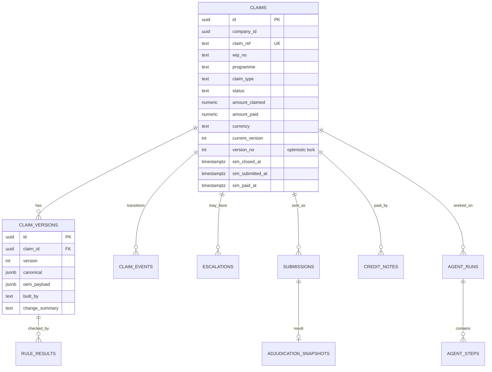

| Instance | Schema | Tables (summary) |
|---|---|---|
| **pg-core** | `warranty` | `claims`, `claim_versions`, `rule_results`, `claim_events`, `submissions`, `adjudication_snapshots`, `credit_notes`, `escalations`, `review_actions`, `baseline_claims` |
| | `agent` | `agent_runs`, `agent_steps`, `agent_replays` |
| | `agent_ckpt` | LangGraph checkpointer tables |
| | `ops` | `jobs`, `outbox`, `sync_state`, `integration_log`, `idempotency_keys`, `tenants`, `tenant_settings`, `users`, `audit_log`, `kpi_snapshots` |
| | `llm` | `llm_calls`, `budgets` |
| **pg-dms** | `autoline` | `al_*` tables per `CLAUDE.md` §6.1–6.2 (fake Autoline incl. its warranty module mirror) |
| **pg-sim** | `oem_sim` | `oem_submissions`, `oem_adjudications`, `oem_preauths`, `oem_credit_notes`, `oem_payment_runs` |
| | `groundtruth` | `seed_issue_manifest`, `scoring_results` |

Conventions: every table has `company_id`, `created_at`, `updated_at`; UUIDv7 primary keys; money as `numeric(12,2)` + `currency`; JSONB for canonical/OEM payloads with a `schema_version` field.

> Naming note: `CLAUDE.md` places claim tables under `al_warranty_*` (as if inside Autoline). Here the **authoritative** claim record lives in our `warranty` schema; the fake Autoline keeps `al_warranty_claims` as a **mirror** written via `DmsPort.write_claim_status`, which is what a real DMS write-back would look like.

### 13.4 Canonical claim (abridged)

```python
class CanonicalClaim(BaseModel):
    schema_version: Literal["1.0"] = "1.0"
    claim_ref: str                       # WC-FD-2026-000123
    company_id: UUID
    programme: Programme
    claim_type: ClaimType                # BASE | EXTENDED | COMPONENT | CAMPAIGN | MAINTENANCE_PROGRAMME | GOODWILL | PARTS
    wip_no: str
    vin: str
    odometer_km: int
    repair_date: date
    wip_closed_at: datetime
    complaint: str; cause: str; correction: str        # 3C
    causal_part: PartRef
    lines: list[ClaimLine]               # labour_op, hours_claimed, hours_actual, parts[], is_related_damage, pay_type
    condition_code: str | None
    symptom_code: str | None
    dtc_codes: list[str]
    evidence: list[EvidenceRef]          # attachment ids + kind
    campaign_code: str | None
    pre_auth_ref: str | None
    tech_support_ref: str | None         # Ferrari ROL / JLR TA case
    technician_ids: list[str]
    totals: Money                        # labour, parts, sublet, VAT 5%, total
    prior_claim_ref: str | None          # continued claims (STAR-aligned)
```

---

## 14. Messaging, jobs, events, real-time

```mermaid
sequenceDiagram
    participant API as api
    participant DB as pg-core
    participant W as orchestrator-worker
    participant R as outbox-relay
    participant UI as web (SSE)

    API->>DB: INSERT ops.jobs (claim.triage, idem_key)
    W->>DB: SELECT ... FOR UPDATE SKIP LOCKED (lease)
    W->>W: run step (agent / deterministic)
    W->>DB: BEGIN; UPDATE claims; INSERT claim_events; INSERT outbox; INSERT next job; COMMIT
    R->>DB: poll outbox WHERE published_at IS NULL
    R-->>API: publish via EventBus (in-proc / Redis later)
    API-->>UI: SSE: claim.status / agent.step / kpi.update
    R->>DB: mark published
```

- **Transactional outbox** guarantees no lost or phantom events.
- SSE endpoint `GET /api/v1/stream?company_id=…` supports `Last-Event-ID` resume (events have monotonically increasing ids).
- Event types: `claim.status`, `agent.step`, `kpi.update`, `escalation.created`, `oem.adjudicated`, `credit_note.posted`, `simclock.tick`.

---

## 15. API surface

All public endpoints under `api` (`/api/v1`), OpenAPI at `/api/v1/openapi.json`, TS client generated with `openapi-typescript`.

| Method & path | Purpose |
|---|---|
| `POST /runs` `{scope: one|batch, claim_ref?, filter?}` | Start agent run(s) |
| `GET /runs/{run_id}` | Run status, cost, counts |
| `GET /stream` | SSE events |
| `GET /claims?status=&programme=&q=` | Pipeline board data |
| `GET /claims/{claim_ref}` | Claim workspace aggregate (job card via DMS, versions, rules, trace, OEM responses) |
| `GET /claims/{claim_ref}/versions/{a}/diff/{b}` | Version diff |
| `POST /claims/{claim_ref}/run` | Run one |
| `GET /review` · `POST /review/{escalation_id}/actions` `{approve|edit|override|write_off}` | Human review queue; resumes LangGraph interrupt |
| `GET /oem/programmes` · `GET /oem/rules-matrix` | Rules matrix with source badges |
| `GET /gateway/inbox?programme=` | Simulated gateway inbox (proxied from `oem-gateway-sim`) |
| `GET /kpis?window=` | KPI bar + baseline column |
| `POST /admin/reset` · `POST /admin/seed` · `GET /admin/accuracy` | Ops (admin role) |
| `GET/POST /simclock` | Pause, resume, speed |
| `GET /healthz` · `GET /readyz` | Probes |

Internal service APIs are versioned separately (`/dms/v1`, `/oem/v1`, `/llm/v1`, `/sim/...`, `/workshop/v1`) and require a service token.

---

## 16. Frontend (Next.js)

- **Next.js 15 App Router**, TypeScript, Tailwind + shadcn/ui, TanStack Query for server state, a small SSE hook that patches the query cache, `@dnd-kit`-free animated board (Framer Motion).
- Routes exactly as `CLAUDE.md` §2 (`/demo/warranty-claims`, `/claims/[claimRef]`, `/oem-rules`, `/review`, `/gateway`), but **no `/api` business routes** — the browser talks to `api` (optionally via a thin Next rewrite for same-origin cookies).
- **OEM claim form renderer**: generic component driven by each programme's payload JSON Schema + a `layout.json` hint (Ford flat lines vs JLR repair sections), so a new OEM needs no new React code.
- Header pills: **LIVE / REPLAY**, **FAKE LLM**, **Simulated OEM Gateway**, **Fake Autoline**. Honesty is part of the UI.
- Tenant branding via `useBrand()`; money via `Intl.NumberFormat` in tenant currency (AED).

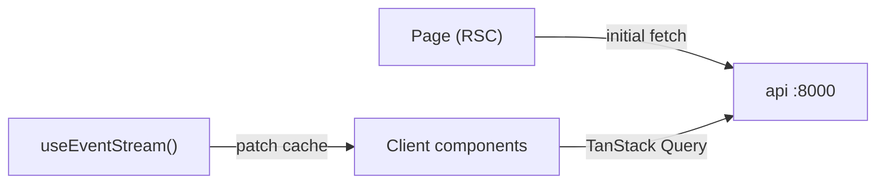

---

## 17. Security, tenancy, configuration

- **AuthN:** OIDC-ready (`authlib`); demo uses seeded users with hashed passwords (demo-only). **AuthZ roles:** `viewer`, `warranty_admin`, `service_manager`, `admin`.
- **Tenancy:** `company_id` from the session → enforced in a repository base class (every query filtered); Postgres RLS policies prepared for real PG.
- **Service-to-service:** short-lived signed service tokens (HMAC JWT) on internal APIs; network policy so only `orchestrator-worker` and `scheduler` reach `oem-hub`/`llm-gateway`, and only `workshop-sim` reaches `pg-sim.groundtruth`.
- **Secrets:** only via `SecretStore`; fake values in `.env.example`; never logged.
- **PII:** redaction in LLM logs and integration logs; data retention settings per tenant.
- **Audit:** every human action and every transition in `ops.audit_log`.
- **Tenant config** (`tenant_settings`): DMS adapter, enabled programmes, currency, VAT, locale, terminology ("WIP/Job Card" vs "RO"), escalation threshold, concurrency, business calendar.

Key env vars:

```
# databases (PGlite today, Postgres later)
DATABASE_URL_CORE=postgresql+psycopg://postgres@localhost:5432/postgres
DATABASE_URL_DMS=postgresql+psycopg://postgres@localhost:5433/postgres
DATABASE_URL_SIM=postgresql+psycopg://postgres@localhost:5434/postgres
DB_POOL_SIZE=1

# adapters
DMS_ADAPTER=autoline_fake
LLM_PROVIDER=fake                 # fake | replay | anthropic | openai | bedrock
OEM_CONNECTOR_DEFAULT=sim         # per-programme override: OEM_CONNECTOR_FORD=sim
BLOB_STORE=local
QUEUE=pg
EVENT_BUS=pg_outbox

# agents
WARRANTY_AGENT_MODEL=claude-sonnet-5-5
WARRANTY_FAST_MODEL=claude-haiku-5-5
WARRANTY_MAX_PARALLEL=4
WARRANTY_SIM_SPEED=1440
WARRANTY_MODE=live                # live | replay
WARRANTY_SEED=42
LLM_MAX_TOKENS_PER_CLAIM=60000
LLM_MAX_TOKENS_PER_BATCH=2000000

# fake credentials (exercise the auth paths)
OEM_FORD_CLIENT_ID=fake-ford-client
OEM_FORD_CLIENT_SECRET=fake-ford-secret
OEM_JLR_API_KEY=fake-jlr-key
AUTOLINE_API_KEY=fake-autoline-key
ANTHROPIC_API_KEY=                # empty → provider refuses to start unless LLM_PROVIDER=fake
```

---

## 18. Observability and operations

| Signal | Tooling | Notes |
|---|---|---|
| Traces | **OpenTelemetry** SDK in every service → OTLP → Jaeger (local) / any backend | One trace per claim step; spans for tool calls, LLM calls, OEM calls, DB |
| Logs | `structlog` JSON, correlation ids (`trace_id`, `claim_ref`, `run_id`, `company_id`) | Redaction processor |
| Metrics | Prometheus `/metrics` | `claims_by_status`, `first_pass_rejection_rate`, `step_latency`, `llm_tokens_total`, `oem_call_errors_total`, `job_queue_depth`, `jobs_dead_lettered_total` |
| Agent tracing | LangSmith-compatible callbacks **optional**, off by default; own `agent_steps` table is the source of truth | |
| Health | `/healthz` (process), `/readyz` (DB + downstreams) | used by compose/K8s |
| Alerts (later) | queue depth, DLQ > 0, window breaches imminent, OEM error rate, budget exhaustion | |

Runbooks live in `docs/runbooks/` (reset demo, replay a run, drain DLQ, rotate OEM credentials, swap PGlite→Postgres).

---

## 19. Testing strategy

| Layer | Tests | Tooling |
|---|---|---|
| Rules engine | one per rule per programme; property tests for date/km | pytest, Hypothesis |
| Payload adapters | golden files canonical→OEM per programme; schema validation | pytest, syrupy snapshots |
| Orchestrator | every transition + guard; idempotency; crash/resume | pytest-asyncio |
| Agents | run each agent with `FakeLLMProvider` on seeded WIPs; assert tool sequence + outcome | pytest |
| Contract tests | `DmsPort`, `OemConnector`, `LLMProvider` shared suites every adapter must pass | pytest parametrised fixtures |
| Integration | full stack on PGlite via `honcho`; acceptance check from `CLAUDE.md` §13 | pytest + httpx |
| DB parity | migrations + repo tests on PGlite **and** Postgres 16 | Testcontainers |
| Frontend | component tests; e2e on control room + claim workspace | Vitest, Playwright |
| Architecture | forbidden imports (agents ↛ groundtruth, domain ↛ vendor SDKs) | `import-linter` |

**Acceptance (carried from CLAUDE.md, adapted):** reset + batch run finishes 24 claims < 6 min at default speed; ≥3 reject→fix→accept; ≥4 sensible escalations; VinFast battery-term claim accepted; replay reproduces the run.

---

## 20. Repository layout

```
WarrantyClaims/
├─ CLAUDE.md                     # product spec
├─ agent.md                      # this file
├─ apps/
│  └─ web/                       # Next.js 15
│     ├─ app/(app)/demo/warranty-claims/{page.tsx, claims/[claimRef]/, oem-rules/, review/, gateway/}
│     ├─ components/warranty/    # KpiBar, PipelineBoard, ClaimCard, AgentFeed, JobCardView, OemClaimForm, RuleChecklist, VersionTimeline, DiffView
│     └─ lib/api/                # generated OpenAPI client + SSE hook
├─ services/
│  ├─ api/                       # FastAPI BFF + SSE
│  ├─ orchestrator/              # worker entrypoint, transitions, escalation policy
│  ├─ scheduler/                 # sim clock, pollers, leader lock
│  ├─ outbox_relay/
│  ├─ dms_connector/             # FastAPI + adapters/{autoline_fake, autoline_keyloop(stub), star_bod(stub)}
│  ├─ oem_hub/                   # FastAPI + registry + middleware
│  ├─ llm_gateway/               # FastAPI + providers/{fake, replay, anthropic(stub), openai(stub)}
│  ├─ oem_gateway_sim/
│  └─ workshop_sim/
├─ packages/py/
│  ├─ wc_core/                   # ports, settings, bootstrap, canonical models, money, ids, clock
│  ├─ wc_db/                     # SQLAlchemy models, repositories, alembic/{core,dms,sim}
│  ├─ wc_rules/                  # pure rules engine
│  ├─ wc_oem/                    # connector protocol, adapters/<programme>.py, connectors/<programme>_sim.py, credentials
│  ├─ wc_agents/                 # LangGraph graphs, tools, prompts, definitions
│  ├─ wc_llm/                    # provider protocol, fake model + policies, remote client
│  ├─ wc_events/                 # outbox, event bus, job queue
│  └─ wc_groundtruth/            # ONLY used by workshop_sim + scoring
├─ rule_packs/                   # ford.yaml, ford_trucks.yaml, jlr.yaml, ferrari.yaml, maserati.yaml, vinfast.yaml, deepal.yaml, foton.yaml
├─ infra/
│  ├─ pglite/                    # package.json + start scripts for pg-core, pg-dms, pg-sim
│  ├─ docker/                    # Dockerfiles per service
│  ├─ compose.yaml
│  └─ otel/                      # collector + jaeger config
├─ seed/
│  ├─ generated/default.warranty.json
│  └─ assets/                    # placeholder photos/PDFs
├─ scripts/                      # seed, reset, run, record-replays, generate-seed (LLM, later)
├─ tests/                        # cross-service integration + acceptance
├─ docs/runbooks/
├─ Procfile                      # honcho: all processes locally
├─ pyproject.toml                # uv workspace
└─ pnpm-workspace.yaml
```

Python is a **uv workspace** (one lockfile, per-service `pyproject.toml`). Lint/format: `ruff`, types: `mypy --strict` on packages; TS: `eslint`, `tsc --noEmit`.

---

## 21. Running locally and in production

### 21.1 Local (no Docker): `honcho start`

```
# Procfile
pg-core:       node infra/pglite/serve.mjs --port 5432 --data ./var/pglite/core --max-connections 4
pg-dms:        node infra/pglite/serve.mjs --port 5433 --data ./var/pglite/dms  --max-connections 2
pg-sim:        node infra/pglite/serve.mjs --port 5434 --data ./var/pglite/sim  --max-connections 2
api:           uv run uvicorn api.main:app --port 8000
dms-connector: uv run uvicorn dms_connector.main:app --port 8100
oem-hub:       uv run uvicorn oem_hub.main:app --port 8200
llm-gateway:   uv run uvicorn llm_gateway.main:app --port 8300
oem-sim:       uv run uvicorn oem_gateway_sim.main:app --port 8400
workshop-sim:  uv run uvicorn workshop_sim.main:app --port 8500
worker:        uv run python -m orchestrator.worker
scheduler:     uv run python -m scheduler.main
relay:         uv run python -m outbox_relay.main
web:           pnpm --filter web dev
```

Commands (mirroring `CLAUDE.md` §12):

```
make setup          # uv sync + pnpm install
make migrate        # alembic upgrade on core, dms, sim
make seed           # load default.warranty.json into pg-dms / pg-sim, baseline into pg-core
make up             # honcho start
make reset          # clear claims, versions, gateway, agent runs; keep WIPs
make run            # headless batch run
make test           # pytest + vitest
```

### 21.2 Containers

`infra/compose.yaml` runs the same processes as containers with healthchecks, `depends_on: condition: service_healthy`, named volumes for PGlite data dirs, and an OTel collector + Jaeger.

### 21.3 Production target (when pilots begin)

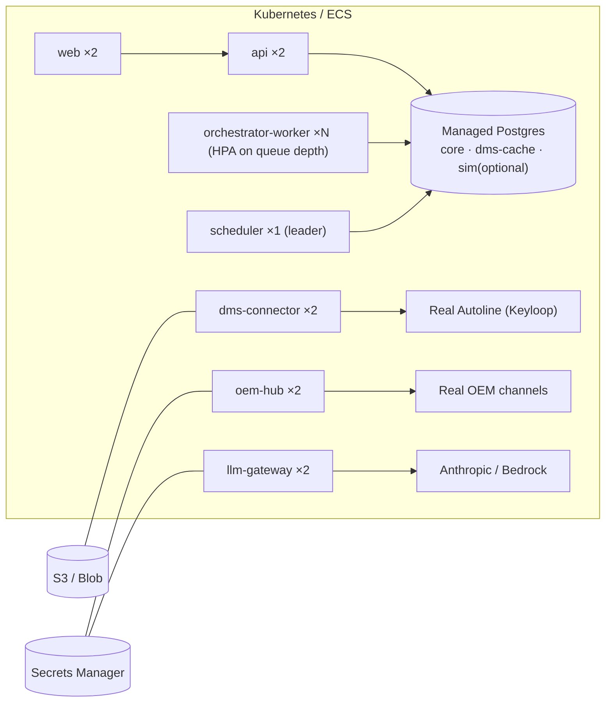

---

## 22. Key sequence flows

### 22.1 Happy path

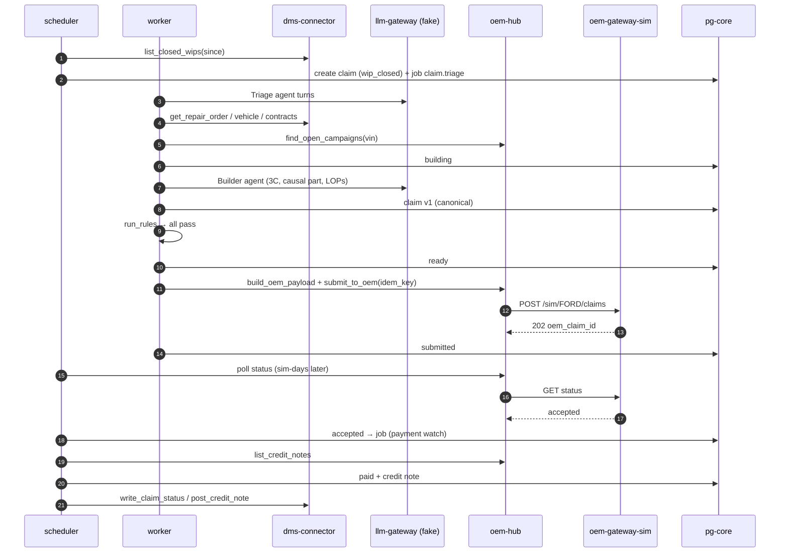

### 22.2 Rejection → fix → resubmit (Ford R03)

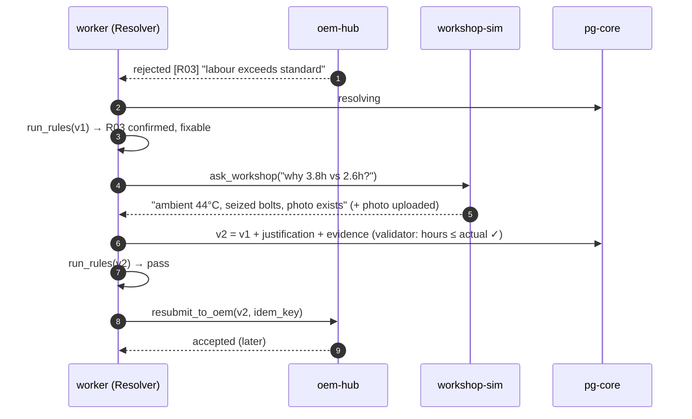

### 22.3 Escalation with human-in-the-loop

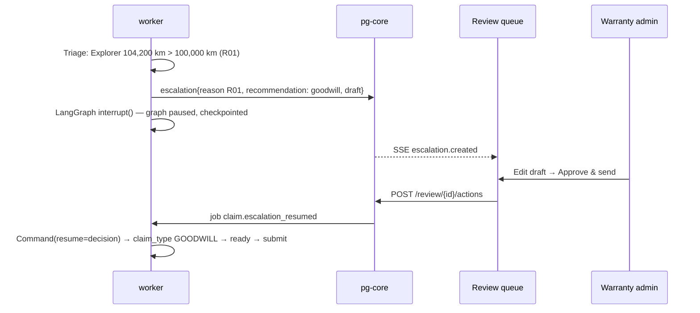

---

## 23. MVP definition

> ### ⭐ MVP — "One desk, six rulebooks, end-to-end on fake everything"
> The smallest system that proves the full loop on a laptop with **no external accounts**, and that is built on the final architecture (no throwaway code).

| Area | **In MVP** ✅ | Not in MVP |
|---|---|---|
| Services | `web`, `api`, `orchestrator-worker` (1 replica), `scheduler`, `outbox-relay`, `dms-connector`, `oem-hub`, `llm-gateway`, `oem-gateway-sim`, `workshop-sim`, 3× PGlite | Kubernetes, autoscaling, Redis/Kafka |
| Ports | All ports defined; adapters: `AutolineFakeAdapter`, `<Programme>SimConnector` ×6, `FakeLLMProvider`, `ReplayProvider`, `PgJobQueue`, `PgOutboxEventBus`, `LocalFsBlobStore`, `SimClock`, `EnvSecretStore` | Any real adapter (stubs only, raising `NotConfigured`) |
| OEMs | FORD, FORD_TRUCKS, JLR, FERRARI, MASERATI, VINFAST rule packs + payload adapters; DEEPAL/FOTON stubs | Real OEM channels |
| Agents | Triage, Builder, Compliance, Submitter, Resolver on LangGraph with fake policies; `ask_workshop`; all §9.5 guardrails | Real LLM; LLM seed generator |
| Lifecycle | Full state machine incl. reject→resolve→resubmit, escalation with interrupt/resume, credit notes, write-back to fake DMS | Chargebacks, parts return logistics |
| Data | Hand-written `default.warranty.json` (24 WIPs + ~150 baseline claims), migrations, reset | Multi-tenant onboarding UI |
| UI | Control room (KPI bar + board + live feed), Claim workspace (job card, OEM form, rules, trace, versions, diff), Rules matrix, Review queue, Gateway inbox; honesty pills | Mobile editing, i18n/RTL Arabic |
| Ops | structlog, OTel traces to Jaeger, health checks, Procfile + compose | Alerting, SSO, RLS |
| Tests | rules, adapters, orchestrator transitions, agent runs on fake LLM, port contract suites, acceptance run | Load tests, Playwright full suite |
| Security | Demo login, service tokens, tenant filter in repositories | OIDC SSO, secrets manager |

**MVP exit criteria**

1. `make reset && make run` processes 24 claims < 6 min at default sim speed.
2. ≥3 claims go reject → fix → accept; ≥4 escalate with sensible drafts; VinFast battery-term claim accepted; duplicate withdrawn; Defender re-typed to CAMPAIGN.
3. Replay mode reproduces a recorded run event-for-event.
4. Swapping `DATABASE_URL_*` to a Postgres 16 container passes the whole test suite unchanged.
5. Every port has at least one contract-tested adapter and one documented stub for the real system.

**MVP build order** (adapts `CLAUDE.md` §13): (1) workspace, PGlite servers, migrations, seed → (2) rule packs + rules engine + tests → (3) canonical model + payload adapters + tests → (4) oem-gateway-sim + sim clock + payments → (5) dms-connector, oem-hub, llm-gateway (fake), workshop-sim → (6) agents one by one, CLI-run on 3 WIPs each → (7) orchestrator, jobs, outbox, SSE, telemetry → (8) UI pages → (9) KPIs + baseline → (10) replay recording, polish.

---

## 24. Roadmap

### Stage 1 — Pilot-ready (one dealer, one brand, copilot mode) · ~6–8 weeks after MVP

Goal: run beside a real warranty admin on real (read-only) data, humans approve every submission.

1. **Real LLM provider** (`AnthropicProvider` with prompt caching of system prompt + rule pack); fake stays as CI default; evaluation harness comparing fake vs real on the seed set.
2. **Copilot mode**: agents prepare, humans click "Submit"; per-tenant autonomy level (`suggest` / `prepare` / `auto-submit under AED X`).
3. **Real Autoline read adapter** (Keyloop partner API or scheduled extract → staging tables), with field-mapping config UI and data-quality report.
4. **Manual-portal connector** for the pilot OEM: generates the ready-to-key claim pack (OEM-formatted PDF + attachments) and lets the admin record OEM status/credit by hand.
5. **Managed Postgres** swap; RLS; backups; migration runbook.
6. **SSO (OIDC / Entra ID)**, role-based permissions, full audit export.
7. **Workshop channel**: replace `workshop-sim` with a real "ask the technician" channel (in-app task list first; Teams/WhatsApp later), with evidence upload from phone.
8. **Submission-window guard**: daily digest + alerts for claims within N days of window expiry.
9. Rule-pack editor (admin UI) with versioning, diff and "last verified" tracking; pack change requires approval.
10. Alerting (queue depth, DLQ, OEM errors, budget), dashboards.
11. Arabic/English UI and RTL support.

### Stage 2 — Multi-brand automation · next 3–6 months

Goal: auto-submit low-risk claims across several brands; measurable KPI improvement.

1. **First real OEM connector** where a channel exists (e.g. Ford claim entry **via DMS** — DMS-mediated transport — or an OEM's dealer API under agreement); others stay manual-portal.
2. **STAR BOD serializer/adapter** for OEMs and DMSs that speak STAR.
3. **Second DMS adapter** (e.g. CDK Drive or another regional DMS) to prove portability; tenant onboarding wizard.
4. **Autonomy policies** per programme/claim type/amount with guardrail simulation ("what would have auto-submitted last month").
5. **Learning from outcomes**: rejection analytics, per-OEM reviewer patterns, suggested rule-pack updates (human-approved), retrieval over past accepted claims (pgvector) to improve 3C drafting.
6. **Pre-authorisation workflow** integrated with OEM technical-assistance channels (JLR prior authority, Ferrari ROL, Ford SSSC).
7. **Parts retention & return** tracking (retention days per OEM, return requests, R13 prevention).
8. **Chargeback / audit defence** module: OEM audit requests, evidence pack assembly, chargeback tracking.
9. **Scale-out**: Redis/NATS event bus, Temporal or SQS for jobs, HPA on queue depth, multi-region readiness.
10. **Cost & quality controls**: per-tenant LLM budgets, model routing (cheap model first, escalate to main on low confidence), offline evals in CI.

### Stage 3 — Platform & network · 6–12+ months

Goal: a multi-tenant product any dealer group can adopt; deeper value beyond claims.

1. **Multi-tenant SaaS**: self-serve onboarding, tenant isolation tiers (shared vs dedicated DB), billing/metering (per claim, per recovered AED).
2. **Connector SDK & marketplace**: third parties ship `wc-connector-*` / `wc-dms-*` packages against the published contract test suites.
3. **More OEMs and regions**: Hyundai/Kia, Toyota/Lexus, Nissan, Chinese brands (Deepal, Foton, others) with region-specific rule packs.
4. **Predictive recovery**: at WIP *open* (not close), predict claimability and required evidence so technicians capture it during the repair; job-card quality scoring per technician.
5. **Campaign & recall intelligence**: proactive VIN matching on every workshop visit, customer outreach drafts.
6. **Goodwill optimisation**: data-backed goodwill proposals with expected OEM contribution.
7. **Extended-warranty / service-contract administration** (third-party warranty providers, insurers) using the same claim pipeline.
8. **OEM-side analytics** (with consent): quality signals from claims back to OEM regional offices.
9. **Compliance & certification**: SOC 2, ISO 27001, UAE PDPL / GDPR data-residency options.
10. **Fully autonomous mode** for mature tenants with continuous auditing and automatic rollback of autonomy on KPI regression.

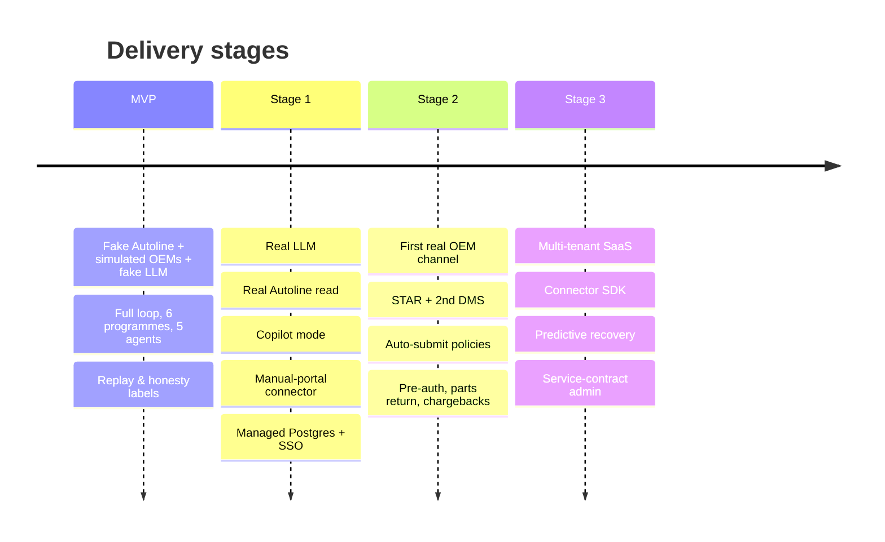

---

## 25. Risks and open questions

| # | Risk / question | Impact | Mitigation / next step |
|---|---|---|---|
| 1 | No public OEM claim APIs; access needs dealer credentials and OEM approval | Real submission blocked | Manual-portal and DMS-mediated connectors first; engage OEM regional offices via the dealer |
| 2 | Autoline API access via Keyloop partner programme (cost/timeline unknown) | Real data blocked | Extract-based adapter; ask the dealer's Keyloop account manager early |
| 3 | PGlite single-connection limits under concurrent services | Throughput, lock waits | Small pools, short txns, 3 instances; Postgres for pilot |
| 4 | Illustrative rule values differ from real OEM manuals (e.g. Maserati Americas 7-day window vs our 30-day illustrative) | Wrong advice if mistaken as real | Source badges; rule-pack verification workflow with the dealer's warranty team before pilot |
| 5 | Fake LLM overstates agent capability | Misleading demo | "FAKE LLM" pill; Stage 1 evals on real models before claims about accuracy |
| 6 | Prompt injection via technician notes / reviewer comments | Wrong actions | Guardrails in code; tool outputs as untrusted data |
| 7 | PII in logs and LLM calls | Compliance | Redaction, retention policies, region-pinned LLM endpoints |
| 8 | Ford Trucks, VinFast, Deepal, Foton dealer processes undocumented | Rule packs are guesses | Mark illustrative; confirm with the dealer's warranty desk |

---

## 26. Sources

Public material consulted for §5 and §7 (verify again before any customer meeting; OEM processes vary by region):

- Ford dealer recall notices (claim entry via DMS or OWS, claim type 31, related-damage lines, SSSC approval): [NHTSA 22V-145](https://static.nhtsa.gov/odi/rcl/2022/RCMN-22V145-6975.pdf), [NHTSA 16V-618](https://static.nhtsa.gov/odi/rcl/2016/RCMN-16V618-8686.pdf), [NHTSA 25V-160](https://static.nhtsa.gov/odi/rcl/2025/RCMN-25V160-0590.pdf), [NHTSA 25V-513](https://static.nhtsa.gov/odi/rcl/2025/RCMN-25V513-9908.pdf)
- JLR (TOPIx procedures, Global Warranty Manual, SRO times, prior authority): [TOPIx Quality Check guide](https://topix.jlrext.com/topix/service/procedure/1695749/ODYSSEY_GENERIC/G4242696/en_US), [NHTSA MC-11015306](https://static.nhtsa.gov/odi/tsbs/2025/MC-11015306-0001.pdf), [NHTSA MC-11036703](https://static.nhtsa.gov/odi/tsbs/2026/MC-11036703-0001.pdf), [NHTSA MC-10209987](https://static.nhtsa.gov/odi/tsbs/2022/MC-10209987-0001.pdf)
- Maserati Aftersales Whitebook (ModisCS+, time limits, cost codes, RO documentation): [Warranty claim filing](https://whitebookaftersales.maserati.com/americas/en-am/whitebook/warranty-management/submitting-a-warranty-claim/warranty-claim-filing.html), [Time limit requirements](https://whitebookaftersales.maserati.com/americas/en-am/whitebook/warranty-management/submitting-a-warranty-claim/time-limit-requirements.html), [Cost codes](https://whitebookaftersales.maserati.com/americas/en-am/whitebook/warranty-management/submitting-a-warranty-claim/cost-codes.html), [RO documentation](https://whitebookaftersales.maserati.com/americas/en-am/whitebook/warranty-management/submitting-a-warranty-claim/Repair-Order-Documentation.html)
- Ferrari (New Modis, Service Entry, Red On Line): [NHTSA MC-10168601](https://static.nhtsa.gov/odi/tsbs/2019/MC-10168601-0001.pdf), [NHTSA MC-10163380](https://static.nhtsa.gov/odi/tsbs/2019/MC-10163380-0001.pdf), [Ferrari warranty & maintenance](https://www.ferrari.com/en-US/auto/car-part-services-warranty-maintenance)
- STAR warranty claim standard: [STAR ProcessWarrantyClaim (5.3.4)](https://schemas.liquid-technologies.com/librarydocs/star/5.3.4/processwarrantyclaim.html), [STAR WarrantyClaimType](https://docs.starstandard.org/guidelines/STAR5134/RepairOrder/ch06s97.html), [ServiceNow warranty claims SOAP API (STAR support)](https://servicenow.com/docs/r/manufacturing/warranty-claims-SOAP-API.html)
- Autoline / Keyloop: [Keyloop Autoline DMS](https://keyloop.com/products/keyloop-autoline-dms), [DMS integration guide (Autoline lineage)](https://www.13labs.au/guides/dealer-management-system-integration-australia), [Autoline BMW OEM API bulletin](https://learnsystime.auxosoftware.com/support/solutions/articles/51000520099-bmw-ris-api-go-live)
- PGlite over the wire protocol: [PGlite Socket docs](https://pglite.dev/docs/pglite-socket), [pglite-socket README](https://unpkg.com/@electric-sql/pglite-socket@0.2.7/README.md), [py-pglite](https://docsearch.algolia.com/mcp/docs/repo/wey-gu/py-pglite)
- Public coverage facts per brand: see `CLAUDE.md` §5.1 (Al Tayer Motors and manufacturer pages).
